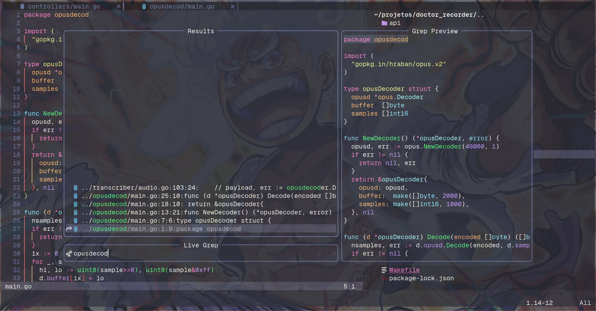
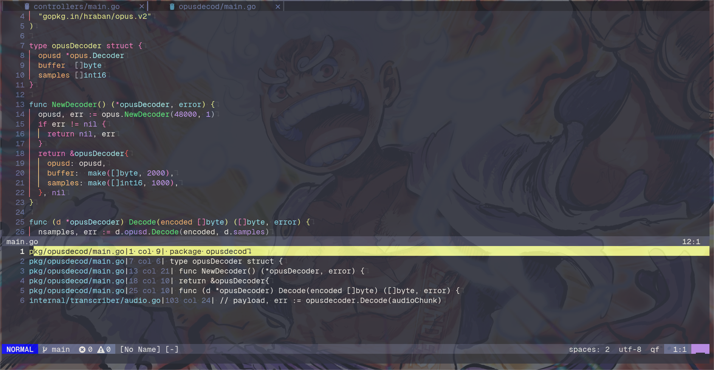
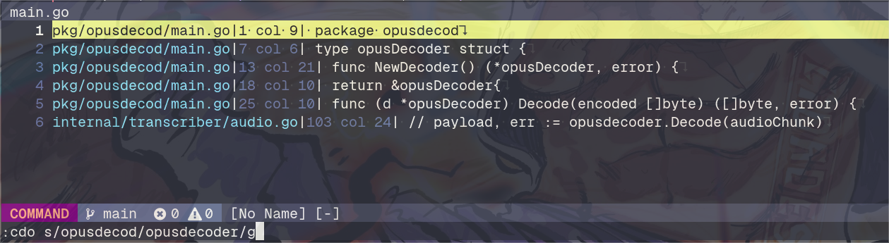

+++
title = "Quick tip: find and replace across files in Neovim"
date = "2023-12-03"
tags = ["neovim"]
categories = ["post"]
draft = false
+++

Renaming something across a whole project is one of those tasks that makes people open VS Code "just for this". You don't need to. With Telescope to search and the quickfix list to apply the change, Neovim does it in four steps.

## Step 1: search with Telescope

Run `:Telescope live_grep` and type the word or pattern you want to replace.



## Step 2: send the results to the quickfix list

With the results on screen, press `Ctrl + q`. Telescope sends every match to the quickfix list.



## Step 3: replace

Now run the substitution on every entry of the list:

```vim
:cdo s/search/replace/g
```

`:cdo` runs the command that follows on each entry of the quickfix list, so the `s/search/replace/g` is applied only to the lines Telescope found. Add a `c` at the end (`s/search/replace/gc`) if you want to confirm each change.



## Step 4: save everything

The changes are still only in the buffers. To write every changed file at once:

```vim
:cdo update
```

`update` only writes the buffer if it was modified, so files that didn't change are left alone. `:wa` also works if you'd rather save every open buffer.

# References

- [Quickfix](https://neovim.io/doc/user/quickfix.html)
- [Telescope](https://github.com/nvim-telescope/telescope.nvim)
